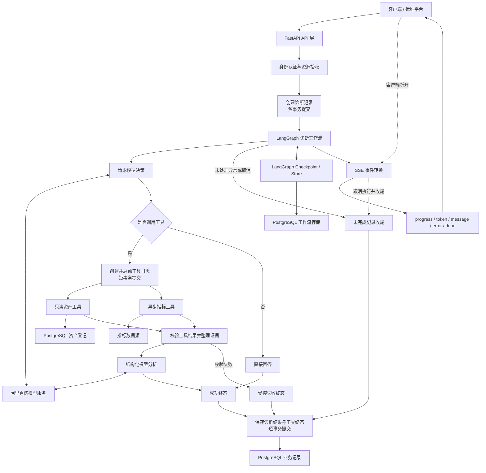

# Ops Pilot

Ops Pilot 是面向运维场景的智能诊断服务，目标是将资产信息、运行指标和运维知识整合为可追溯、可验证的分析结果，帮助运维人员定位问题、核实依据并明确后续排查方向。

项目以生产环境为建设目标，采用 FastAPI、LangGraph 和 PostgreSQL 构建后端，通过标准 HTTP 接口与 SSE 提供诊断能力，并逐步形成可部署、可观测、可恢复的服务体系。

> 本文描述产品的目标能力与架构方向，不作为所有功能已实现或生产就绪的声明。具体可用能力以发布版本及其验收结果为准。

## 业务目标

- 缩短从接收问题到收集证据、形成诊断结论的时间。
- 将分散的资产与指标信息组织为可核查的诊断依据。
- 明确区分观测事实、分析推测与缺失信息，避免无依据结论。
- 为每次诊断提供身份归属、执行状态、工具记录和结果追溯。
- 在超时、依赖故障、连接中断等情况下保持清晰的失败语义和资源边界。
- 支持从只读诊断逐步扩展到知识辅助分析和受审批控制的操作流程。

典型请求：

> 请分析 payment-api 的运行情况，列出依据、可能原因和需要继续确认的问题。

目标输出包含分析摘要、证据及来源、可能原因、缺失信息和建议排查步骤。缺少必要数据时明确说明，不将模型推测或测试数据当作真实观测。

## 长期目标：商业化运维诊断服务

构建面向企业运维场景、基于真实数据和可追溯证据提供诊断服务的商业产品，使团队能够在明确的权限与成本边界内完成问题调查、结果复核和任务交接。

### 目标用户与产品定位

优先面向已有资产库和监控系统、但仍需人工跨平台收集信息的运维与研发团队。初期聚焦特定系统的只读诊断，例如服务延迟异常的初步排查，提供证据整理、可能原因与后续验证建议。

产品与现有监控平台协作：监控平台负责持续采集和告警，Ops Pilot 围绕具体问题组织查询与分析。诊断结论必须受数据覆盖范围、时效和质量约束，不承诺自动识别所有根因或自动修复所有故障。

### 商业化能力目标

| 方向 | 目标能力 |
| --- | --- |
| 诊断质量 | 使用真实故障样本评估证据准确性、结论可核查性和建议有效性；数据不足时明确说明 |
| 客户数据接入 | 对接实际资产与监控平台，管理字段映射、凭据、数据时间范围和接入故障 |
| 权限与隔离 | 校验用户、任务与资源归属；多组织服务形态下落实组织级数据隔离 |
| 可靠运行 | 建立容量评估、备份恢复、服务告警、版本升级与故障响应机制 |
| 产品使用 | 提供接入配置、诊断历史、执行状态、错误反馈和结果反馈能力 |
| 成本管理 | 记录单次诊断的模型与工具消耗，设置调用额度和异常消耗限制，支持成本归属 |
| 服务交付 | 提供可重复部署、版本支持、客户验收和持续维护流程 |

### 价值验证与交付方向

以明确的客户场景和有限数据源验证价值，再扩展能力范围。验收重点包括：收集必要证据所需时间、数据准确性与时效、结论追溯能力、排查建议的实际帮助，以及单次诊断成本与维护成本。商业化成立还需验证客户采用意愿与付费需求，不以功能数量或演示效果代替。

交付形态可根据客户需求选择客户环境部署或多组织服务平台，分别明确网络接入、权限隔离、升级和维护责任；不预设同时建设两种形态。

只读诊断是产品基础，知识检索与受审批控制的操作作为扩展能力独立验收。商业化目标不代表当前已经达到生产交付标准。

## 核心功能

### 资产与指标查询

- 从资产数据库读取服务、主机及关联资源的登记信息。
- 通过只读工具获取诊断所需的运行指标。
- 校验工具参数和返回数据，标注来源、采集时间及适用范围。
- 区分资产登记状态与实时健康状态。
- 为测试数据提供显式标记，使其与生产观测明确分离。

### 智能诊断工作流

- 通过显式工作流组织数据查询、结果校验、模型分析和任务结束。
- 约束工具调用范围与执行次数，防止无边界执行。
- 将结构化事实与模型解释分开保存和呈现。
- 对无数据、非法输入、工具失败和分析失败提供明确分支。
- 输出带证据引用的分析结果与待确认问题。

### 实时进度与结果输出

- 提供普通 HTTP 响应与 SSE 流式响应。
- 使用 `progress`、`token`、`message`、`error` 和 `done` 等语义事件，区分执行进度、工具结果、模型文本、最终结果和错误。
- 通过 `done.status` 表达成功、受控失败或未处理异常，不以 HTTP 200 或传输结束判断业务成功。
- 定义客户端断开后的执行策略与状态收尾规则。
- 使用统一运行标识关联流式事件、诊断记录和工具日志。

### 任务持久化与恢复

- 保存分析任务、执行状态、耗时、工具记录和结果摘要。
- 使用短事务，避免外部 HTTP 或模型等待期间占用业务事务。
- 将业务记录、工具日志与工作流 Checkpoint 分开管理：业务表负责审计和产品状态，Checkpoint 负责图状态与恢复。
- 即使业务数据和 Checkpoint 使用同一个 PostgreSQL 实例，也不共享一次业务事务。
- 定义中断恢复边界，识别重复工具执行并控制其影响。
- 对保存失败、未处理异常、客户端断线和未完成任务提供可追踪的收尾机制。

### 身份认证与资源授权

- 验证用户身份，将分析任务与会话绑定到实际用户。
- 校验任务归属和资产访问范围。
- 在工具执行层实施数据访问约束，避免仅依赖提示词限制权限。
- 防止通过修改请求中的用户标识或会话标识访问其他用户的数据。
- 对日志中的凭据与敏感信息进行脱敏。

### 运行保障与可观测性

- 复用异步 HTTP 客户端，明确连接生命周期。
- 设置外部调用超时、并发限制与取消传播规则。
- 使用 Trace ID 关联请求、工作流、工具执行与错误日志。
- 提供启动、就绪和存活检查，区分依赖不可用与进程异常。
- 通过行为测试和故障注入验证成功、失败、越权、超时与持久化异常。

## 扩展方向

以下能力按业务需要独立评估和交付，不作为基础诊断的前置依赖。

### 运维知识检索

接入运维文档、故障案例及操作规范，支持元数据过滤、来源引用和无检索结果处理。检索内容作为分析依据之一，不代替实时观测。

### 人工审批

对需要变更资源的流程设置审批节点，校验审批身份，明确拒绝、恢复与重复执行的处理方式。只读诊断与写操作保持独立授权边界；已提交的外部操作不能依靠数据库回滚撤销。

## 总体架构

该图描述目标职责划分。身份认证、资源授权、恢复和生产数据接入按对应阶段独立验收。业务记录与 Checkpoint 即使使用同一个 PostgreSQL 实例，也不共享同一个业务事务；取消本地任务也不能自动撤销已经提交的外部操作。

## 技术选型

| 层次 | 技术与职责 |
| --- | --- |
| API 服务 | FastAPI，负责请求校验、依赖管理和响应输出 |
| 工作流 | LangGraph，负责诊断步骤、状态流转与恢复边界 |
| 数据类型 | Pydantic，负责参数、工具结果与结构化输出校验 |
| 模型服务 | 阿里百炼，通过 OpenAI 兼容接口调用 |
| 持久化 | PostgreSQL，保存资产、分析记录、工具日志及工作流存储 |
| 异步访问 | 异步 PostgreSQL 驱动与 HTTPX，管理外部 I/O |
| 数据库变更 | Alembic，管理结构版本与迁移 |
| 服务交付 | Docker、Kubernetes 与 CI/CD |

依赖与运行镜像采用明确版本，升级通过验证后交付。模型、数据库连接及凭据通过环境配置注入，密钥不写入代码或镜像。

## 诊断流程

1. 接收诊断请求，验证身份及资源访问权限。
2. 创建分析记录并提交短事务，建立运行标识与请求追踪上下文。
3. 模型判断是否需要调用授权范围内的只读工具；无需工具时进入直接回答路径。
4. 调用工具前保存工具日志，外部等待期间不持有业务数据库事务。
5. 校验工具数据，记录来源、测试标记、执行耗时和结果，组织可追溯证据。
6. 根据证据调用模型生成结构化分析；工具或证据校验失败时进入受控失败路径。
7. 持续输出进度、消息、文本片段、错误和最终语义事件。
8. 保存成功或失败业务终态；发生未处理异常或客户端断线时，收尾仍未完成的诊断及工具记录。
9. 释放 HTTP、数据库和流式响应相关资源。

诊断结果应回答：发现了什么、依据是什么、哪些属于推测、还缺少什么信息，以及下一步如何验证。

## 生产部署与交付目标

- 使用可追溯的镜像版本，支持自动构建、发布验证和版本回滚。
- 支持 Kubernetes 多副本部署，明确共享存储和会话状态的访问边界。
- 使用配置与密钥管理机制隔离环境差异。
- 配置资源限制及健康探针，支持优雅终止和长连接收尾。
- 面向阿里云 ACK 与 ACR 建立部署路径，明确网络、权限和数据访问方案。
- 发布期间验证普通请求、SSE 长连接和任务状态的一致性。
- 分别管理应用版本回滚与数据库迁移，避免把应用回滚视为业务数据撤销。

生产验收以实际证据为准，覆盖权限隔离、数据真实性、资源释放、失败处理、恢复边界及发布回滚，不以接口可访问作为唯一标准。
